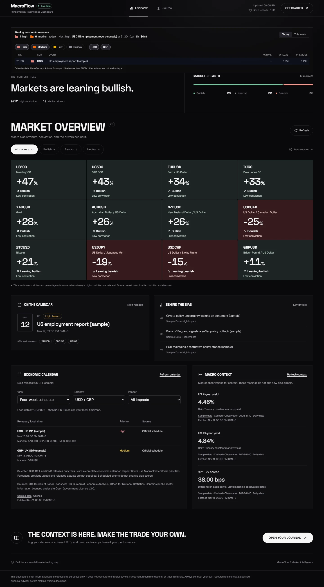
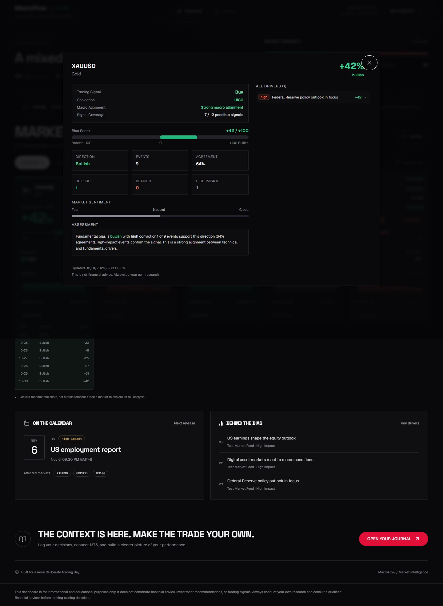
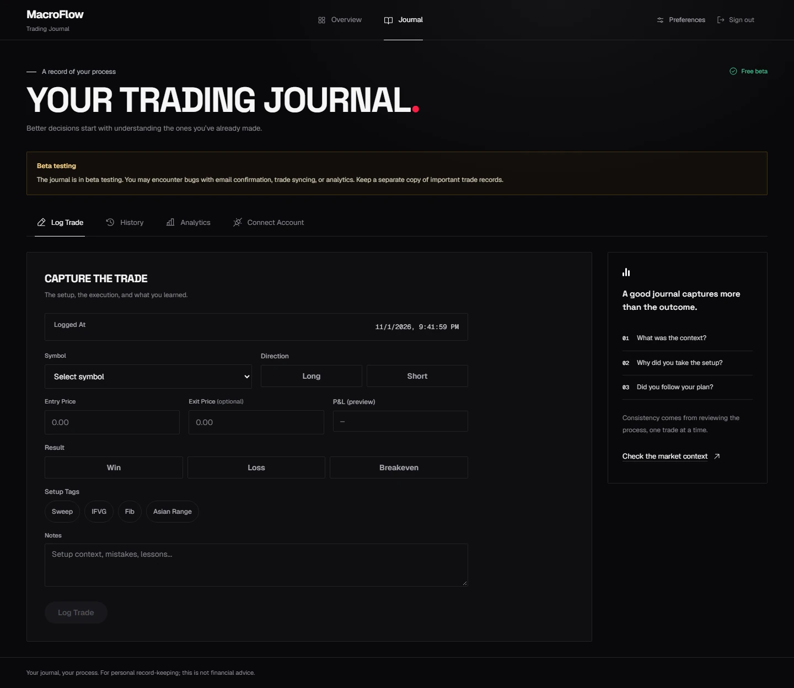
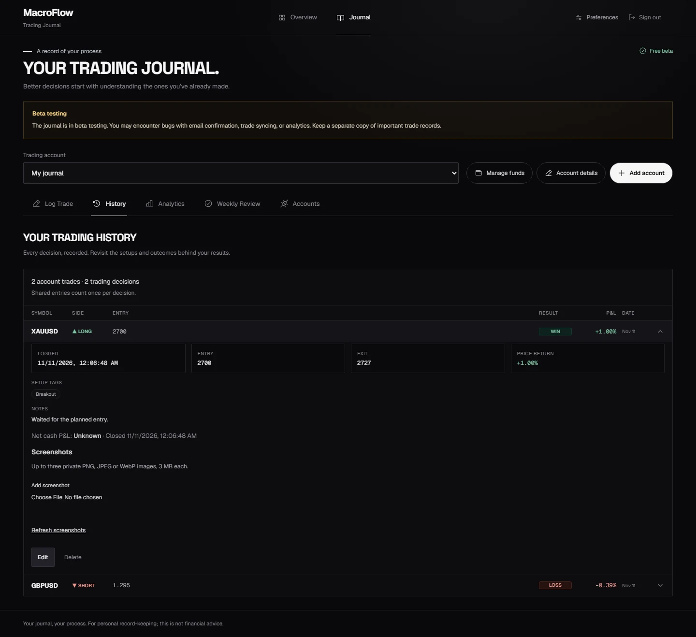
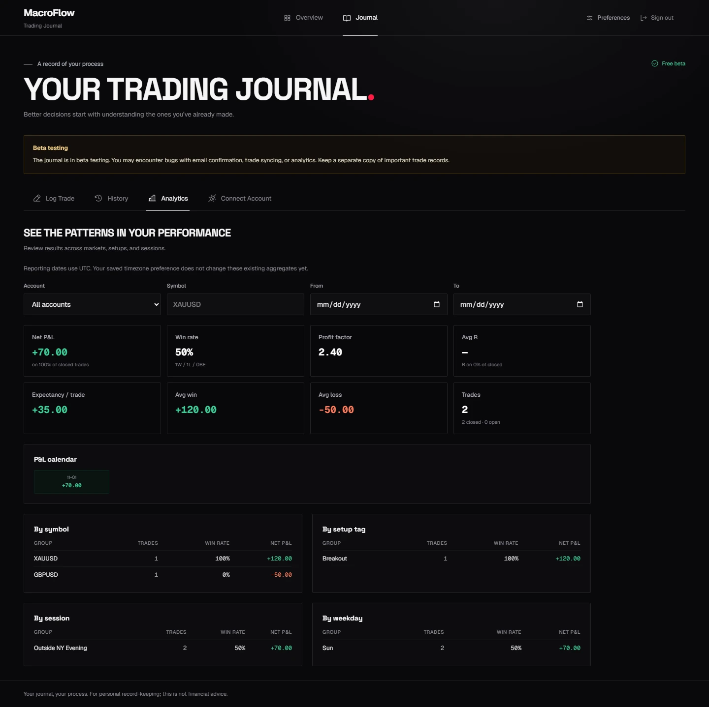
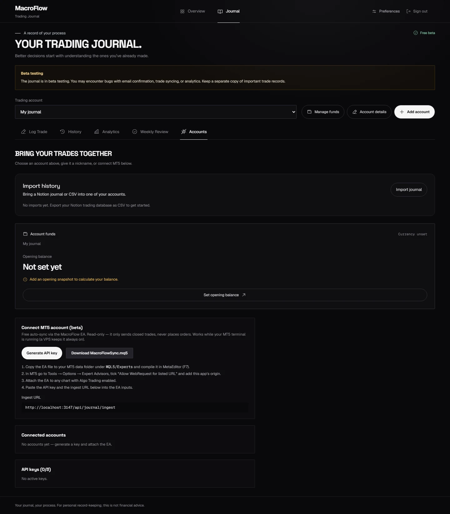
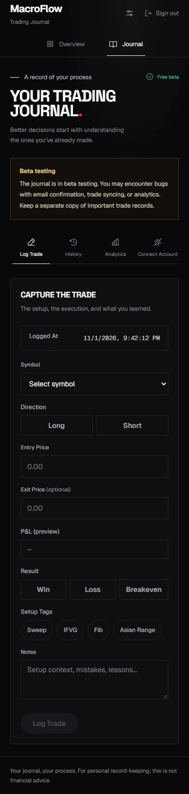

# MacroFlow

**Macro context for your technical analysis. A journal for your trading decisions.**

MacroFlow combines economic trends, verified release surprises, policy news, and market observations into an explainable directional bias. Inspect the contributing points, compare the macro view with your technical setup, and use the trading journal to review decisions over time.

[Live application](https://macro-flow-ecru.vercel.app) · [Scoring](#how-scoring-works) · [Getting started](#getting-started) · [Documentation](#documentation)



> **Beta:** Journal, signup, synchronization, and analytics features remain under active testing. Email confirmation depends on the deployment's SMTP configuration. Keep an independent copy of important trade records.

## Workspace

- **Market overview:** Compare signed bias, conviction, evidence agreement, and recent history across 12 markets. Bullish and bearish readings are ranked by absolute bias strength.
- **Market analysis:** Inspect rule contributions, opposing evidence, category totals, market confirmation, source health, and timestamps.
- **Economic context:** Review upcoming releases, archived consensus, and available actuals alongside official release schedules and Treasury yield context.
- **Trading journal:** Record technical setups, entries, exits, results, tags, notes, and available macro context. Review history, performance by setup and session, and weekly summaries.
- **Account management:** Maintain separate account identities, balances, and funds histories. Record one manual decision across selected accounts with independent fills and results.
- **Imports and MT5:** Import a CSV journal or synchronize closed trades using the downloadable MT5 Expert Advisor and revocable journal keys. Broker passwords remain in MT5.

Supported markets: **Gold, GBP/USD, Nasdaq 100, Dow Jones, Bitcoin, S&P 500, EUR/USD, USD/JPY, USD/CHF, AUD/USD, USD/CAD, and NZD/USD.**

Review the macro evidence, compare it with your technical setup, record the trade, and revisit its outcome. MacroFlow does not automatically validate technical setups or execute trades.

## How scoring works

### Inputs to points

The server combines timestamped policy and market news, transformed FRED/ALFRED economic trends, measured dollar/yield observations, and eligible economic release surprises. A surprise requires an actual value and consensus archived before the release; an upcoming event alone does not earn surprise points.

Asset-specific rules assign signed points. Economic trends receive half weight; the current equity model also applies a growth/rate regime adjustment. Exact duplicates are removed, opposing contributions remain visible, and each category is capped **after** its signed contributions are summed. Future, expired, unsupported, or incorrectly attributed evidence is excluded from the relevant scoring path.

Headline safeguards distinguish economic indices from equity indices, actual crypto regulation from unrelated or negated statements, and central-bank forecast revisions from interest-rate actions.

### Reading the percentage

The production display uses:

```text
displayed bias = round(100 × net category-capped points / asset category capacity)
```

The result is bounded from −100% to +100%. Positive readings indicate bullish macro pressure; negative readings indicate bearish pressure. The API retains net points, category contributions, and the denominator for inspection. Direction zones and strength use the capped raw point score, so the display and raw score are different units.

For example, Gold's category capacity is 260 points. A net score of +70 displays as **+27%**. Missing categories remain in the denominator: the display measures a share of rule capacity, not the percentage of available evidence that agrees.

**Bias is not a calibrated prediction probability.** An 80% bias reading does not establish an 80% likelihood of a correct forecast. The optional outcome-calibration pipeline is separate and may report probability as unavailable.

### Conviction and market alignment

**High Conviction requires an absolute displayed bias of at least 50%**, equally for bullish and bearish readings. Reaching that threshold is necessary but not sufficient. The engine also requires:

- At least three supporting categories, supporting high-impact evidence, and at least 60% event agreement with the net direction.
- Fresh, complete macro context and supporting structured economic evidence.
- Recent market observations that confirm the macro direction.
- A resolved equity regime where applicable.

Readings between −49% and +49% cannot receive High Conviction. Larger readings can still have low conviction when evidence or alignment checks fail. The API computes percentage and conviction together; the dashboard guards against inconsistent older responses. Bias responses use `Cache-Control: no-store`, while input caches retain bounded freshness and expiry.

Macro direction and a qualified signal remain distinct. The engine can show a directional macro view while withholding a buy/sell signal because confirmation or input health is insufficient.

## Validation and research status

The scoring investigation used portfolio reference commit `e52443b` and compared individual changes before combining them into an isolated restoration candidate. Production contains verified correctness fixes. **The experimental fixed-scale and regime-restoration policy is not the live default.**

Three conclusions are kept separate:

1. **Correctness:** Tests verify calculations, category caps, evidence attribution, timestamp handling, and the ±50% conviction boundary.
2. **Behavior:** Controlled replays show which inputs and policies change points, direction, and qualification.
3. **Predictive performance:** Better subsequent market-direction accuracy has **not** been established by the available comparisons.

Historical evaluation uses inputs available at each prediction timestamp, the next hourly open, and four contiguous hours of subsequent prices. Reports include sample sizes, abstentions, signal frequency, price coverage, uncertainty, and matched simple baselines. Where returns are shown, costs are explicit and illustrative.

Known limits include incomplete historical news/consensus archives, unavailable quality-checked Gold outcome prices in the evaluated sample, and no UK actual-release adapter in the current structured surprise pipeline. Inspected historical data are development evidence, not an untouched holdout. Legacy synthetic and revised-data artifacts must not be used as proof of predictive accuracy.

Prospective tooling records immutable input bundles, model/source hashes, timestamps, release provenance, and variant outputs. Failed or stale captures remain visible but are excluded from eligible comparisons. **Collection is not enabled automatically by deployment:** an operator must run the collector against a frozen protocol on a durable host. The final evaluator refuses to open the registered evaluation period early.

Read the [restoration evaluation](docs/restoration-final-report-2026-11-10.md) and [GBPUSD/Bitcoin corrections](docs/gbpusd-bitcoin-followup-2026-11-10.md) for results and limitations. These reports describe their execution dates; later deployment does not turn experimental results into validated forecasts.

## Product tour

Screenshots refreshed on November 11, 2026 show the current interface and all 12 supported markets. Market readings are calculated by the production scoring implementation from illustrative sample inputs; journal views use synthetic trades in disposable local accounts. These are interface examples, not live quotes or measured trading performance. No production journal records or credentials are included. See [screenshot provenance](docs/images/README.md).

<details>
<summary><strong>Market analysis</strong></summary>

Inspect the evidence behind a directional reading and its market context.



</details>

<details>
<summary><strong>Journal and history</strong></summary>

Record decisions and revisit their execution, setup, and notes.




</details>

<details>
<summary><strong>Analytics and MT5 connection</strong></summary>

Review recorded outcomes and configure closed-trade synchronization.




</details>

<details>
<summary><strong>Mobile workspace</strong></summary>

<p>
  
  
</p>

</details>

## Architecture

**Next.js 16, React 19, and TypeScript** provide the application and server routes. The interface uses Tailwind CSS, Motion, and Phosphor icons. Supabase Auth handles identity, PostgreSQL stores journal data, and Upstash Redis supports shared input caching and bias history. Zod validates data; Vitest, Playwright, and axe-core support verification.

The market pipeline aggregates inputs on the server and sends scored results to the overview and detail pages. Journal routes enforce identity, access, and ownership checks before reading or writing user records. MT5 synchronization uses a separate key-authenticated ingest route.

| Route | Responsibility |
| --- | --- |
| `/api/bias` | Scored readings, evidence, alignment, health information, and optional probability estimates. |
| `/api/calendar` | Selected official BLS/BEA/ONS schedules for informational context. |
| `/api/calendar/consensus` | Weekly forecast calendar, backed by a pre-release consensus archive and mapped US actuals for eligible scoring surprises. |
| `/api/macro-context` | Independent Treasury yield context panels; these panels do not add separate scoring inputs. |

## Getting started

### Prerequisites

- Node.js **20.9 or later** and npm.
- A Supabase project for authentication and journal storage.
- Provider configuration and Upstash Redis for the market features you intend to use.
- Docker Desktop only for the disposable database/authentication integration suite.

### Local setup

```bash
git clone https://github.com/Jomesly/MacroFlow.git
cd MacroFlow
npm ci
```

Copy [.env.example](.env.example) to `.env.local` only if a local configuration does not already exist. Populate values privately; never commit the real environment file.

| Configuration | Purpose |
| --- | --- |
| `SUPABASE_URL`, `SUPABASE_SERVICE_ROLE_KEY` | Server database access. The service-role key must never enter client code. |
| `NEXT_PUBLIC_SUPABASE_URL`, `NEXT_PUBLIC_SUPABASE_ANON_KEY` | Public Auth configuration for the same Supabase project. |
| `NEXT_PUBLIC_APP_URL` | Exact application origin for authentication links and origin checks. |
| `AUTH_SIGNUP_ENABLED` | Application signup rollout switch; defaults to disabled. |
| `UPSTASH_REDIS_REST_URL`, `UPSTASH_REDIS_REST_TOKEN` | Shared market cache and history. |
| Provider and RSS settings | Economic data and news source configuration; see the environment template. |

Prepare the database using the [authentication setup guide](docs/auth-setup.md), then review the feature migrations you need:

- [Trading accounts](docs/trading-accounts.md), [account funds](docs/account-funds.md), and [CSV imports](docs/journal-imports.md).
- [Forecast archive schema](supabase/calendar-forecasts.sql) for verified consensus evidence.
- [Private screenshot storage](supabase/journal-screenshots.sql) before enabling journal screenshots.

Inspect and back up existing databases before migration. Some original schema scripts are not safe to rerun blindly; migrations are not automatically applied when the app starts.

```bash
npm run dev
```

Open [localhost:3000](http://localhost:3000). The public dashboard is at `/`; the authenticated workspace is at `/journal`.

### Authentication and email

Keep email confirmation enabled and configure production SMTP before opening public registration. Match the app origin, Supabase Site URL, and confirmation/recovery redirects. Optional Turnstile configuration and token-hash email templates are covered in the [production email guide](docs/production-email-setup.md).

## Development and verification

| Command | Purpose |
| --- | --- |
| `npm run dev` | Start the local development server. |
| `npm test` | Run unit and regression tests. |
| `npm run lint` | Run ESLint. |
| `npx tsc --noEmit` | Check TypeScript types. |
| `npm run test:ui` | Run dashboard, detail-page, and account-screen browser checks. |
| `npm run build` | Create an optimized production build using the configured environment. |
| `npm start` | Serve an existing production build. |

Install Chromium before running browser checks:

```bash
npx playwright install chromium
npm run test:ui
```

The UI suite uses deterministic fixtures and starts a local server when needed. For isolated authentication, database, and journal integration tests on Windows:

```powershell
powershell -NoProfile -ExecutionPolicy Bypass -File scripts/test-auth-local.ps1
```

This runner provisions a disposable local Supabase stack; it does not reset a hosted database. See [local integration testing](docs/auth-setup.md#local-integration-tests-windows) for prerequisites and focused runs.

### Research utilities

| Command | Purpose |
| --- | --- |
| `npm run research:evaluate -- --data=path/to/archive` | Compare isolated variants on historical inputs and four-hour outcomes. |
| `npm run research:init -- --out=data/prediction-research-experiment` | Freeze the configured prospective protocol and source hashes before its start. |
| `npm run research:capture -- --out=data/prediction-research-experiment` | Save one immutable hourly prediction bundle. |
| `npm run research:watch -- --out=data/prediction-research-experiment` | Run the foreground collector on a persistent host with private environment configuration. |
| `npm run research:final -- --out=data/prediction-research-experiment --prices=path/to/prices` | Evaluate the registered period after it closes. |

The supplied protocol has fixed dates and model hashes. Inspect it before initializing an experiment. A changed model requires a separately registered future comparison; do not overwrite a frozen manifest, backfill predictions, or reuse inspected data as fresh validation. Research commands do not change the live scoring policy.

## Deployment

`main` is the production branch. Its Vercel integration must finish successfully and assign the production domain before a pushed commit is live.

1. Review the exact diff and tracked files for secrets, personal data, and generated artifacts. Run checks appropriate to the change.
2. Confirm required database migrations and hosting configuration. Keep credentials in the hosting secret store.
3. Push the reviewed commit, verify the deployment's commit SHA and readiness, and inspect the production API and rendered pages.
4. Verify the scoring model version, provider health, cache behavior, and High Conviction threshold in live responses. For authentication or journal changes, also verify the affected account flows.

Database changes need their own compatibility review. Roll back to a compatible build without deleting users, trades, or access grants. See [rollout and troubleshooting](docs/auth-setup.md#rollout-and-troubleshooting).

## Security and data handling

- Keep provider tokens, database service-role keys, cron secrets, MT5 journal keys, and real environment files out of Git, client bundles, screenshots, and logs. `.env.example` contains names and safe placeholders only.
- Only intentionally public configuration belongs in `NEXT_PUBLIC_*` variables. Public configuration does not replace identity and ownership checks.
- Local prediction captures, raw research archives, private exports, browser artifacts, deployment metadata, and credentials must remain untracked. Publish only reviewed, sanitized reports or fixture-based screenshots.
- Inspect staged files before pushing. `.gitignore` protects new additions; it does not remove files already tracked or erase Git history.
- Report suspected credential exposure privately to the repository owner. Revoke and rotate exposed credentials; removing a file alone does not invalidate them.

## Repository map

```text
src/app/          Pages, authentication actions, and API routes
src/components/   Market, journal, and account interfaces
src/lib/          Scoring, data adapters, research evaluation, and access checks
supabase/         SQL scripts, email templates, and database assertions
public/           Downloadable MT5 Expert Advisor
scripts/          Research collectors, comparisons, migrations, and test utilities
tests/e2e/        Browser and integration checks
docs/             Setup guides, reviewed reports, and curated screenshots
```

## Documentation

- **Scoring:** [Regression investigation](docs/prediction-regression-2026-11-10.md), [restoration evaluation](docs/restoration-final-report-2026-11-10.md), [GBPUSD/Bitcoin fixes](docs/gbpusd-bitcoin-followup-2026-11-10.md).
- **Research:** [Bias and probability](docs/macro-probability.md), [macro alignment](docs/macro-alignment-v3.md), [backtesting methodology](docs/backtesting-plan.md).
- **Setup:** [Authentication](docs/auth-setup.md), [production email](docs/production-email-setup.md), [provider validation](docs/market-context-provider-validation.md).
- **Journal:** [Trading accounts](docs/trading-accounts.md), [account funds](docs/account-funds.md), [imports](docs/journal-imports.md), [glossary](GLOSSARY.md).

MacroFlow provides informational market context and personal record-keeping tools. Bias scores, research results, and illustrative screenshots are not guarantees of future market direction or trading performance.

### Four-hour narrative forecasts

The dashboard now shows experimental directional forecasts across all 12 markets, using each market's own price action, recent news and macro context even when structured confirmation is incomplete. Scores are not win probabilities. See [forecast methodology and operational checks](docs/news-forecast.md).
