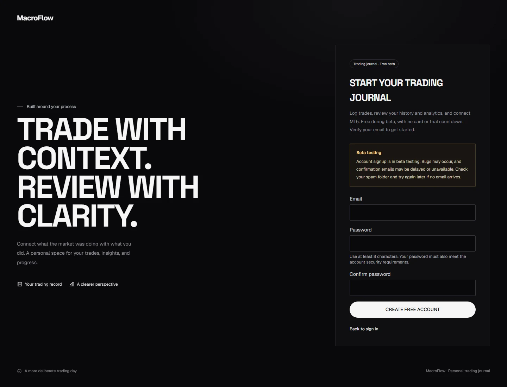
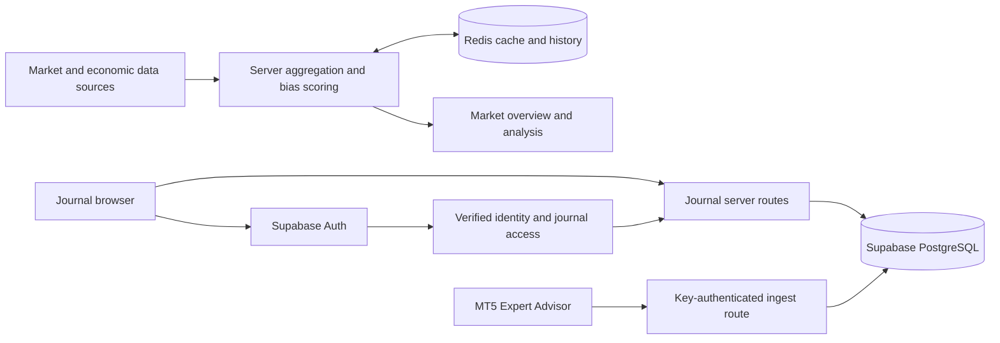

# MacroFlow

**Market context and a personal trading journal, in one workspace.**

MacroFlow brings macroeconomic signals, economic releases, and market sentiment alongside your trading record. Review the context, record a decision, and return to the journal to understand its outcome.

The probability update replaces signed rule percentages with validated four-hour direction estimates. Until a supported model has sufficient independent outcomes, the dashboard shows **Probability unavailable**. See the [probability methodology, validation status and data workflow](docs/macro-probability.md).

[Open MacroFlow](https://macro-flow-ecru.vercel.app) · [Product tour](#product-tour) · [Get started](#getting-started) · [Authentication setup](docs/auth-setup.md)


> **Beta release** — The journal and account signup are under active testing. Bugs may affect email confirmation, trade synchronization, or analytics. Confirmation email delivery remains limited until production SMTP is configured. Keep a separate copy of important trade records.

## What you can do

| Workspace | Capabilities |
| --- | --- |
| **Market overview** | Compare bias, conviction, agreement, and recent history across gold, GBP/USD, Nasdaq 100, Dow Jones, and Bitcoin. |
| **Market analysis** | Inspect the signals behind a score, economic-event context, sentiment, and data availability. |
| **Economic calendar** | Filter selected official BLS/BEA/ONS releases by date, currency and MacroFlow priority; inspect source links and the next relevant release. |
| **Macro context** | Review direct US Treasury 2Y/10Y daily yields and their matched-date spread, with observation dates and cache status. |
| **Trade journal** | Record entries, exits, direction, results, setup tags, and notes. Retain market-bias context when available. |
| **Trading accounts** | Choose multiple manual accounts for one shared entry, with independent fills and cash results. Track opening balances, deposits, withdrawals and audited funds corrections. See [setup and behavior](docs/account-funds.md). |
| **History** | Search and review trades, filter the record, and expand individual decisions. |
| **Analytics** | Review performance totals, a P&L calendar, and breakdowns by market, setup, session, and weekday. Monetary metrics show their data coverage. |
| **MT5 connection** | Download the Expert Advisor and manage revocable journal keys for closed-trade synchronization. Broker passwords stay in MT5. |
| **Individual accounts** | Sign up, confirm an email address, recover a password, and use a journal scoped to the signed-in account. |

## How the workflow fits together

1. **Review the market.** Compare markets and inspect the analysis behind a bias score. Check source status and timestamps before using the context.
2. **Create your journal.** Register, confirm your email, and complete the welcome screen. Verified accounts with an active beta grant can access the journal.
3. **Record the decision.** Enter a trade manually, or connect the MT5 Expert Advisor to synchronize closed trades while the terminal is running.
4. **Review the outcome.** Use History to revisit the trade and Analytics to look for patterns. Check monetary-metric coverage when some records contain only percentage results.

## Product tour

These are actual application screenshots captured with representative market fixtures and a disposable local test account. They contain no production account data, broker credentials, or usable API keys. Market values and trade results are illustrative, not current quotes or performance claims. Select a section to view its full screen.

<details open>
<summary><strong>Market analysis — understand the score</strong></summary>

Inspect the components behind a market's bias and the information available for that reading.


</details>

<details>
<summary><strong>Signup — individual accounts with a clear beta notice</strong></summary>

Create an account, verify its email address, and continue to the journal. The notice sets expectations about beta bugs and email delivery limitations.



</details>

<details open>
<summary><strong>Journal — capture the trade and its context</strong></summary>

Record the setup, execution, result, and notes from a dedicated trading workspace.


</details>

<details>
<summary><strong>History — revisit individual decisions</strong></summary>

Filter recorded trades and expand a row to inspect its details and notes.


</details>

<details>
<summary><strong>Analytics — review patterns and data coverage</strong></summary>

Explore recorded outcomes, the P&L calendar, and performance breakdowns. Missing monetary results are reflected in coverage instead of silently treated as complete data.


</details>

<details>
<summary><strong>MT5 — connect a terminal without sharing a broker password</strong></summary>

Download `MacroFlowSync.mq5`, create a journal key, and configure the EA in MT5. The screenshot shows the setup screen before a key is generated.


</details>

<details>
<summary><strong>Mobile — the overview and journal on a smaller screen</strong></summary>

The same workspace adapts to a phone, including market cards, journal navigation, and trade inputs.

<p>
  
  
</p>

</details>

## Architecture

Next.js App Router provides pages and server routes. Market data is aggregated and scored on the server, with Redis supporting shared cache and bias history. Supabase Auth handles identities; server-side access checks scope journal operations to the verified user. PostgreSQL stores journal records and access grants.

Calendar and macro-context panels load independently through `/api/calendar` and `/api/macro-context`. They provide informational context and do not introduce new bias-scoring inputs. Provider validation, cache limits, build-time feature switches, and remaining release prerequisites are documented in [market context provider validation](docs/market-context-provider-validation.md).

The weekly forecast calendar uses `/api/calendar/consensus`. Its verified pre-release consensus archive and mapped FRED actuals supply structured surprise evidence to the four-hour alignment engine. Official BLS/BEA/ONS schedules remain on `/api/calendar` for the existing market context panels. See [macro alignment](docs/macro-alignment-v3.md) and the [production merge review](docs/production-merge-2026-11-10.md).

To run the weekly-calendar failure and recovery regressions against a built app on port 3130:

```powershell
$env:CALENDAR_TEST_URL = 'http://localhost:3130'
npx playwright test --config playwright.calendar.config.ts
```

The forecast archive uses `supabase/calendar-forecasts.sql`; installations that already applied it need no further SQL for this merge.



| Layer | Technology |
| --- | --- |
| Application | Next.js 16 · React 19 · TypeScript |
| Interface | Tailwind CSS 4 · Motion · Phosphor icons |
| Identity and persistence | Supabase Auth · PostgreSQL |
| Cache and history | Upstash Redis |
| Validation | Zod |
| Verification | Vitest · Playwright · axe-core |

## Getting started

Named trading accounts now support broker names, account numbers/IDs, and optional nicknames. Before using this version, apply `supabase/trading-accounts.sql` after the existing journal/auth migrations. See [trading account setup](docs/trading-accounts.md) for migration, account selection, and local verification.

Notion/CSV imports are available from **Add account → Import existing journal** and **Accounts → Import journal**. Apply `supabase/journal-imports.sql` after the funds migration. See [CSV import setup and behavior](docs/journal-imports.md) for mapping, duplicates, capital snapshots and safe batch undo.

### Prerequisites

- Node.js **20.9 or later** and npm.
- A Supabase project for authentication and journal storage.
- Provider credentials and Upstash Redis for the market features you intend to run.
- Docker Desktop only for the isolated database/authentication integration suite.

### Run locally

```bash
git clone https://github.com/Jomesly/MacroFlow.git
cd MacroFlow
npm ci
```

Copy `.env.example` to `.env.local` and fill in your configuration. Preserve an existing `.env.local` instead of overwriting it. Local environment files must remain untracked.

| Environment variables | Purpose |
| --- | --- |
| `SUPABASE_URL`, `SUPABASE_SERVICE_ROLE_KEY` | Server-side database access. The service-role key must stay on the server. |
| `NEXT_PUBLIC_SUPABASE_URL`, `NEXT_PUBLIC_SUPABASE_ANON_KEY` | Public Auth configuration for the same Supabase project. |
| `NEXT_PUBLIC_APP_URL` | Exact app origin, such as `http://localhost:3000`. Used for authentication links and origin checks. |
| `AUTH_SIGNUP_ENABLED` | App signup rollout switch. Defaults to `false`; it does not disable Supabase's public signup API. |
| `NEXT_PUBLIC_TURNSTILE_SITE_KEY` | Optional public Turnstile widget key. The matching secret belongs in Supabase. Follow the deployment order in the email setup guide. |
| `UPSTASH_REDIS_REST_URL`, `UPSTASH_REDIS_REST_TOKEN` | Market-data cache and bias history. |
| Provider, RSS, and cron settings | See the comments in [.env.example](.env.example). |

Before enabling signup, follow [Authentication and database setup](docs/auth-setup.md). For a **new database**, review the schema scripts in this order:

1. `supabase/schema.sql`
2. `supabase/subscribers.sql`
3. `supabase/journal-autosync.sql`
4. `supabase/signup-login.sql`

Existing databases need inspection and a backup first. Some prerequisite scripts are not rerunnable migrations; do not reapply them blindly to a live project.

```bash
npm run dev
```

Open [localhost:3000](http://localhost:3000). The public overview is at `/`; account routes include `/signup`, `/login`, and `/forgot-password`. The authenticated workspace is at `/journal`.

### Email confirmation and beta access

Keep email confirmation enabled. Supabase's built-in email sender is unsuitable for public registration and can prevent confirmation or recovery messages from being delivered. A beta notice does not raise its quota.

Use the [production email walkthrough](docs/production-email-setup.md) when configuring SMTP, sending-domain DNS, capacity limits, production redirect URLs, email templates, and optional Turnstile protection.

The supplied token-hash email templates support verification in another browser. Standard Supabase PKCE email links require the browser that initiated the request. See the [authentication guide](docs/auth-setup.md) for both flows.

## Development and verification

| Command | Purpose |
| --- | --- |
| `npm run dev` | Start the local development server. |
| `npm test` | Run the Vitest unit suite. |
| `npx tsc --noEmit` | Check TypeScript types. |
| `npm run lint` | Run repository ESLint checks. |
| `npm run test:ui` | Exercise the dashboard and account screens in Chromium. |
| `npm run build` | Produce the optimized application build. |
| `npm start` | Serve an existing production build. |

Install Chromium before the first browser run:

```bash
npx playwright install chromium
npm run test:ui
```

The UI suite uses deterministic market fixtures and checks responsive layouts, filters, keyboard interactions, reduced motion, provider errors, and automated accessibility rules. It starts a local server on port 3000 when needed. Use a local environment with signup enabled and Turnstile unset for the regular account-screen checks.

For the isolated authentication, database, and journal integration suite on Windows:

```powershell
powershell -ExecutionPolicy Bypass -File scripts/test-auth-local.ps1
```

The runner creates a disposable local Supabase stack and a separate app on port 3137. It does not use hosted credentials or reset a hosted database. It covers confirmation, recovery, journal isolation, permissions, MT5 ingest access, account switching, and session refresh beyond token expiry. Allow several minutes for the expiry test. Focused runs and Turnstile checks are documented in [auth-setup.md](docs/auth-setup.md#local-integration-tests-windows).

Browser captures are written to the ignored `.artifacts/ui-review/` directory. Curated, compressed screenshots used here live in [docs/images](docs/images). They are documentation assets, not visual regression baselines.

The production integration passes repository-wide lint. See the [integration report](docs/production-merge-2026-11-10.md) for the current verification scope and remaining validation limits.

## Deployment

`main` is the production branch. A push updates Git; the hosting integration must complete its own deployment before the new build is live.

1. Review the target database and apply the required journal/auth migration before deploying dependent application code.
2. Set production environment variables in the hosting dashboard. Match `NEXT_PUBLIC_APP_URL`, Supabase Site URL, and the exact `/auth/confirm` redirect URL to the deployed origin.
3. Deploy the app and verify existing-account login, email confirmation, password recovery, journal access, and market-data error states.
4. Keep public registration limited until SMTP, provider capacity, and abuse protection are ready. Changing `AUTH_SIGNUP_ENABLED` requires a restart or redeploy; public environment changes require a fresh build.

For rollback, close signup and redeploy a compatible build while preserving Auth users, trades, profiles, and access grants. Do not return to the old subscriber-only authorization model for newly provisioned beta users. See the [authentication rollout notes](docs/auth-setup.md#rollout-and-troubleshooting) for compatibility constraints.

## Security and data handling

- Keep service-role credentials, provider secrets, cron secrets, and real environment files out of Git, client bundles, screenshots, and logs. `.env.example` contains configuration names and safe examples only.
- Public Supabase configuration does not replace server-side identity, access, or ownership checks. Keep database grants and account isolation aligned with the supplied schema.
- MT5 journal keys are revocable. Generate and copy them privately; never include a real key in documentation or a support screenshot.
- Local assistant instructions, prompts, editor settings, test artifacts, and credential files are ignored. Ignore rules prevent new additions; they do not erase files already present in Git history.
- Report suspected credential exposure privately to the repository owner. Revoke and rotate an exposed credential before considering history cleanup; removing a file alone does not invalidate it.

## Repository map

```text
src/app/          Pages, authentication actions, and API routes
src/components/  Market, journal, and account interfaces
src/lib/         Data aggregation, scoring, storage, and access checks
supabase/        SQL scripts, email templates, and database assertions
public/          Downloadable MT5 Expert Advisor
scripts/         Data utilities, migration tooling, and local test runner
tests/e2e/       Browser and integration checks
docs/            Setup guides, screenshots, and backtesting documentation
```

Further reading: [Authentication setup](docs/auth-setup.md) · [Production email setup](docs/production-email-setup.md) · [Glossary](GLOSSARY.md) · [Backtesting methodology](docs/backtesting-plan.md)

MacroFlow provides informational market context and personal record-keeping tools. Bias scores and sample screenshots are not trading recommendations or guarantees of performance.


### Official market context and journal reviews

The economic calendar now uses selected BLS/BEA/ONS releases, with source links and MacroFlow editorial priorities. It does not supply consensus forecasts, previous values or actuals. Macro context uses direct Treasury 2Y/10Y daily yields and matching-date spreads; new DXY/VIX feeds are disabled. Analysis dialogs link to external reference charts while embedding and custom history remain pending provider approval.

The journal includes a weekly performance review by closing week, account filters and setup/session breakdowns. Money totals are not combined across accounts. Trade history reads all pages, rather than silently stopping at the database response cap.

Screenshot uploads are off by default. Apply [the private-bucket migration](supabase/journal-screenshots.sql) in a preview database, validate owner isolation, then set `NEXT_PUBLIC_JOURNAL_SCREENSHOTS_ENABLED=true` and rebuild. Limits: three PNG/JPEG/WebP images per trade, 3 MB each. The server streams private images after permission/ownership checks; there are no public image URLs.

Run `node scripts/validate-market-context.mjs <preview-url>` for hosted source checks. Run `powershell -NoProfile -File scripts/test-auth-local.ps1` for the disposable Supabase/Auth/Storage integration suite. See [provider validation](docs/market-context-provider-validation.md) for release gates and deferred scope.
